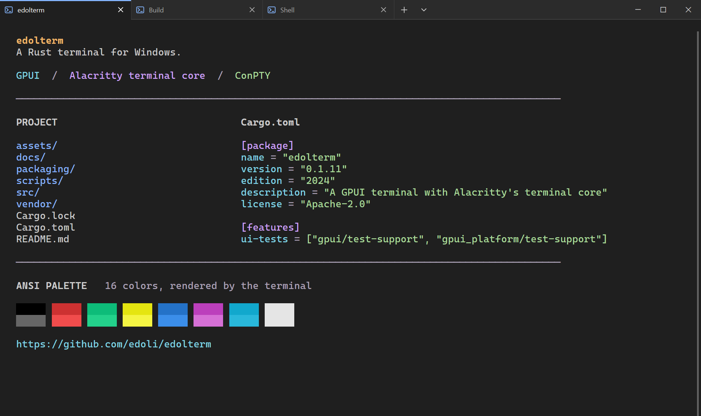

<h1 align="center">Edolterm</h1>

<p align="center">
  A GPU-rendered terminal for Windows, built in Rust.<br>
  GPUI for the interface. Alacritty for the terminal core. ConPTY for your shells.
</p>

<p align="center">
  <a href="https://github.com/edoli/edolterm/releases">Download</a> ·
  <a href="#features">Features</a> ·
  <a href="#configuration">Configuration</a> ·
  <a href="docs/usage.md">User guide</a> ·
  <a href="docs/development.md">Development</a>
</p>

<p align="center">
  <a href="https://github.com/edoli/edolterm/actions/workflows/ci.yml"></a>
  <a href="https://github.com/edoli/edolterm/releases"></a>
  
</p>



Edolterm brings a tabbed interface, configurable shortcuts, and a graphical settings
editor to Alacritty's terminal engine. Run PowerShell, Command Prompt, and WSL in
one place, move live tabs between windows, and return to your working folders
the next time you launch.

## Features

- **Tabs and windows:** Reorder, rename, and move live tabs between windows.
- **Shell profiles:** PowerShell, CMD, WSL, and custom shells.
- **Customization:** Fonts, shortcuts, light/dark themes, and 17 color schemes.
- **Terminal tools:** Search, scrollback, text selection, clickable links, and file drops.
- **Windows integration:** Explorer menus, taskbar profiles, and default-terminal support.
- **Session restoration:** Reopen windows, tabs, and working folders.

## Installation

Download packages from [GitHub Releases](https://github.com/edoli/edolterm/releases)

### Build from source

Install the Rust MSVC toolchain, Visual Studio C++ Build Tools, and the Windows SDK,
including `fxc.exe` for release shader compilation. Then run:

```powershell
git clone https://github.com/edoli/edolterm.git
cd edolterm
cargo run --locked --release
```

## Contributing

Bug reports and pull requests are welcome. For terminal issues, include your
Windows version, shell, font, color scheme, and a small command or sequence that
reproduces the problem. For build instructions and checks, see the
[development guide](docs/development.md).

## Acknowledgments and license

Edolterm is built on [GPUI](https://github.com/zed-industries/zed/tree/main/crates/gpui),
[Alacritty's terminal core](https://github.com/alacritty/alacritty/tree/master/alacritty_terminal),
and [Microsoft's ConPTY](https://github.com/microsoft/terminal).
Most built-in palettes come from Microsoft Terminal; the Ubuntu palette follows
the Ubuntu 24.04 WSL profile. Third-party notices are included in distribution bundles.

Edolterm declares **Apache-2.0** in its [package metadata](Cargo.toml).
Vendored Alacritty code and Microsoft components retain their respective
[Apache-2.0](vendor/alacritty_terminal/LICENSE-APACHE) and
[MIT](assets/licenses/Microsoft-Terminal-LICENSE) notices.
